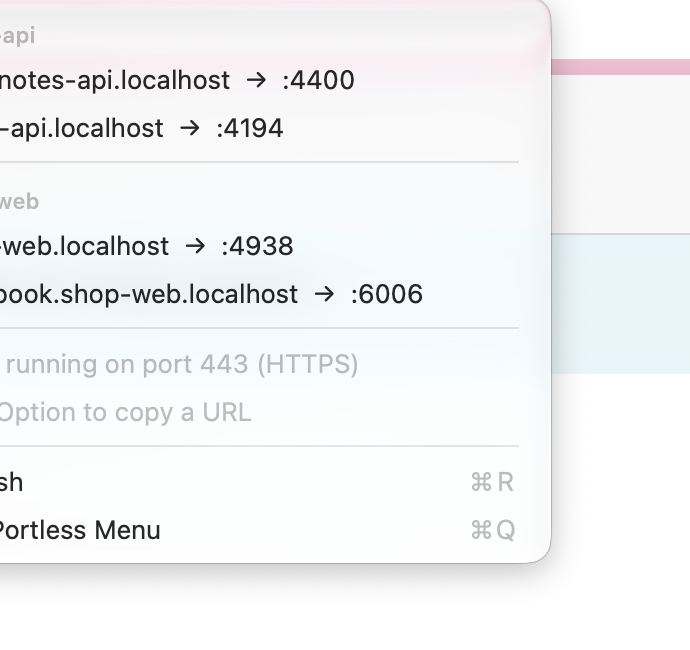

# Portless Menu

Portless Menu is a macOS menu bar app. It lists every URL that [portless](https://portless.sh) currently serves. It reads the portless state directory and applies the same rules as `portless list`.



## Requirements

- macOS 15 or later.
- Swift 6 (Xcode or the command line tools).
- portless, with its proxy running.
- Node.js, for the dummy projects.

## Build

```sh
cd PortlessMenu
scripts/bundle.sh
```

The script builds a release binary and writes `PortlessMenu/build/Portless Menu.app`. It signs the app ad hoc. You can run it again at any time.

## Run

```sh
open "PortlessMenu/build/Portless Menu.app"
```

The menu bar shows a network symbol and the number of active URLs. The menu groups URLs by project. The project is the label before the TLD, so `klavio-forms.comfort.localhost` is in `comfort`. Click a URL to open it in your default browser. Hold Option to copy the URL instead. The menu updates when portless changes its state files. It also checks every 5 seconds for routes whose process stopped.

To print the active URLs and exit, run the binary with `--list`:

```sh
"PortlessMenu/build/Portless Menu.app/Contents/MacOS/PortlessMenu" --list
```

## Test

```sh
cd PortlessMenu
swift test
```

## Try it with the dummy projects

The `dummy-projects` folder has two small Node servers. `notes-api` returns JSON. `shop-web` returns an HTML page. Each one runs its `dev` script through `portless run`.

```sh
dummy-projects/start.sh
curl -sk https://notes-api.localhost
curl -sk https://shop-web.localhost
"PortlessMenu/build/Portless Menu.app/Contents/MacOS/PortlessMenu" --list
dummy-projects/stop.sh shop-web
dummy-projects/stop.sh
```

`start.sh` writes process IDs and logs to `dummy-projects/.run/`. `stop.sh` stops only the processes that `start.sh` started. With no arguments it stops both projects. Both scripts are safe to run more than once.
